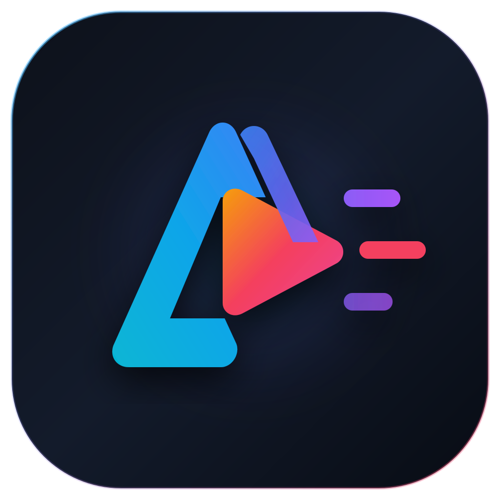

<p align="center">
  
</p>

<h1 align="center">AVE (Android Video Editor)</h1>

<p align="center">
  <b>AVE is an open-source Android video editing software powered by ArtCraft's pure-Rust FilmCraft media engine and a native Kotlin/Jetpack Compose UI framework.</b><br>
  Credits to the upstream engine maintainers, <a href="https://github.com/storytold">storytold</a> and the ArtCraft ecosystem.
</p>

<p align="center">
  <a href="https://github.com/artcraft-android/filmcraft-android/releases"></a>
  <a href="https://apps.obtainium.imranr.dev/redirect?r=obtainium://add/https://github.com/artcraft-android/filmcraft-android"></a>
</p>

<p align="center">
  
  
  
  
  
  
</p>

<p align="center">
  <a href="#editing">Editing</a> ·
  <a href="#filters-and-transitions">Filters &amp; transitions</a> ·
  <a href="#text">Text</a> ·
  <a href="#captions-and-text-to-speech">Captions &amp; speech</a> ·
  <a href="#export-and-home">Export &amp; Home</a> ·
  <a href="#sideways">Sideways</a> ·
  <a href="#planned-features">Planned features</a> ·
  <a href="#building-instructions">Building</a>
</p>

<br>

<p align="center">
  
  <br>
  <sub>The editor: the preview, the transport row, a timeline with lanes for captions, text and sound, and the tools.</sub>
</p>

<br>

## Editing

<table align="center">
<tr>
<td align="center"></td>
<td align="center"></td>
</tr>
<tr>
<td align="center"><sub>A clip selected: split, delete, retime, audio, filters, effects and more</sub></td>
<td align="center"><sub>Speed, from 0.1× to 10×</sub></td>
</tr>
</table>

<br>

## Filters and transitions

<table align="center">
<tr>
<td align="center"></td>
<td align="center"></td>
</tr>
<tr>
<td align="center"><sub>31 filters, previewed on the clip</sub></td>
<td align="center"><sub>50 transitions, every tile animated</sub></td>
</tr>
</table>

<br>

## Text

<p align="center">
  
  <br>
  <sub>Text: presets, the phone's fonts, colours and layout.</sub>
</p>

<br>

## Captions and text to speech

<table align="center">
<tr>
<td align="center"></td>
<td align="center"></td>
</tr>
<tr>
<td align="center"><sub>Captions, made on the phone</sub></td>
<td align="center"><sub>Text to speech, with built-in and natural voices</sub></td>
</tr>
</table>

<br>

## Export and Home

<table align="center">
<tr>
<td align="center"></td>
<td align="center"></td>
</tr>
<tr>
<td align="center"><sub>Export at 720p, 1080p or 4K, 24 to 60 fps</sub></td>
<td align="center"><sub>Home: four ways to start, then your projects</sub></td>
</tr>
</table>

<br>

## Sideways

<p align="center">
  
  <br>
  <sub>Sideways, the preview sits beside the timeline.</sub>
</p>

<br>

## Planned features

FilmCraft for Android is in beta.

| Area | Status |
|---|---|
| Projects from the photo library, files or blank; open shared videos; autosave; rename, duplicate, delete | ✅ |
| The timeline: trim, move, reorder, split, delete, duplicate, replace, undo and redo; pinch to zoom | ✅ |
| Speed (0.1–10×, the sound keeps its pitch), freeze frame, volume, fades, extract audio, voiceover | ✅ |
| 31 filters, 23 effects, opacity, mirror and flip; move, scale and turn on the preview | ✅ |
| 50 transitions, intro and outro, apply to all | ✅ |
| Text: presets, the phone's fonts, colours and layout | ✅ |
| Captions made on the phone (Whisper, downloaded once when you ask), edited and burned in | ✅ |
| Text to speech: two built-in voices and nine natural voices (Kokoro, downloaded once when you ask) | ✅ |
| 11 aspect ratios, blank clips | ✅ |
| Export at 720p, 1080p or 4K, 24 to 60 fps, saved to Movies and shared | ✅ |
| Upright and sideways layouts | ✅ |
| Stock music, templates | ⬜ |
| Generative AI, cloud storage, accounts | 🚫 FilmCraft is a local app |

<sub>✅ works today · 🚧 in progress · ⬜ not started · 🚫 not planned</sub>

<br>

## Building Instructions
*One Gradle command builds the whole app: it compiles the Rust engine with [cargo-ndk](https://github.com/bbqsrc/cargo-ndk) and generates the Kotlin bindings.*

* Clone this repository
* Make sure you have at least 4 GB of free disk space
* enter `apps/filmcraft-android/android` and run `./gradlew assembleRelease`, or open that folder in Android Studio and press Run.

Build time dependencies:

<details>
  <summary>required tools</summary>

  ```
      rustup (it installs the Rust release and Android targets rust-toolchain.toml names)
      cargo install cargo-ndk --version 4.1.2 --locked
      Android SDK (API 37) and NDK 29.0.14206865
      JDK 17 or newer
  ```
</details>

*Builds are only tested on Windows 11.*

<br>

## License

[MIT](LICENSE-MIT) OR [Apache-2.0](LICENSE-APACHE), at your option. FilmCraft for Android is not affiliated with Adobe;
Premiere is a trademark of Adobe Inc.

<br>

## Misc info for myself

Try to use [semantic commit](https://kapeli.com/cheat_sheets/Semantic_Commits.docset/Contents/Resources/Documents/index)
messages. Use `feat:` / `fix:` / `chore:` / `docs:` / etc.
